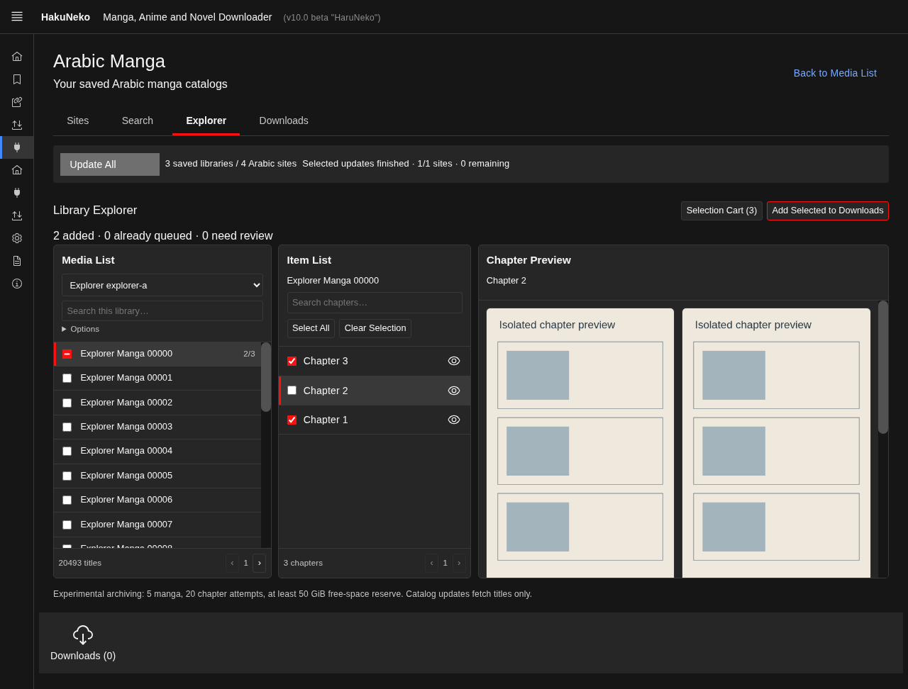
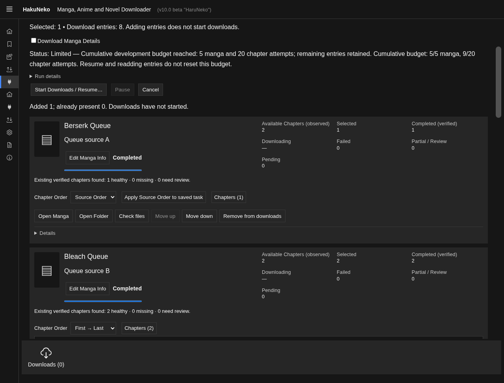

# تصحيح تجربة Windows — Explorer والتحديد والتنزيلات

نقطة البداية: `fb482dfd90134725a416c8f6251a80a2ac64f8c9` على `feature/arabic-manga-hub`، مطابقة للمنشور عند البدء. لم توجد تعديلات محلية غير محفوظة. لم يُعدل master أو مخطط SQLite v11 أو حدود 5 مانجات/20 محاولة تراكمية واحتياطي 50 GiB.

## المرجع البصري والواجهة

رُوجعت الصور السبع: قوائم Media List وItem List الأصلية مدمجة وتبقى ظاهرة مع صور الفصل على اليمين؛ أما Explorer السابق فكان بلوحتين واسعتين ومعاينة تستبدلهما. استُلهم ترتيب الأصل دون تغيير نجومه أو تنزيلاته اليدوية.

أصبح Explorer ثلاثة أعمدة مستقلة التمرير: Media List باختيار مصدر محفوظ وبحثه المحلي، Item List ببحث الفصول وSelect والعين، ثم Chapter Preview بشبكة عمودين. تبقى القوائم أثناء تبديل الفصل. يعيد `ChapterPreview` استخدام `Chapter.Update` ومكون `viewer/Image` الأصلي و`Page.Fetch`؛ لا DownloadHandle ولا محاولة تنزيل أو ميزانية للمعاينة. `PreviewImage` يؤجل جلب الصور حتى اقترابها من مجال العرض، ويعزل أخطاء الصور، مع حفظ النسب. نتيجة جلب فصل قديم لا تكتب في المعاينة الجديدة، ويُلغي تدمير مكون الصورة جلبها بالطريقة الأصلية.

المصدر الطويل أو متعدد اللغات والعناوين العربية والإنجليزية يستعمل `dir=auto` وعرضًا محدودًا وtooltip للاسم. احتُفظ بصفحات 25 مانجا و100 فصل؛ لا آلاف صفوف DOM. على الشاشات الضيقة تلتف المعاينة أسفل القوائم. لا خيار Arabic sites first داخل Explorer.

رُوجعت لقطات Electron فعليًا: اكتُشف أولًا أن تذييل القوائم يختفي خلف شريط التنزيل القديم، فاستُبدل ارتفاع viewport المحسوب بتخطيط يستخدم المساحة المتاحة. اللقطتان أدناه من بيانات اختبار معزولة على Linux، وليستا صور مواقع حية أو شهادة مظهر Windows:

## الفهارس والتحديد

يُعيد أمر `libraries` في عامل البحث بيانات المصادر التي لها مراجع محلية سليمة غير فارغة فقط. لا يُعد تشغيل موصل أو نجاح آخر تحديث شرطًا لقراءة فهرس سابق. لا تعود مصفوفات العناوين الكبيرة إلى الواجهة لمجرد بناء قائمة المواقع. إشعار قبول فهرس جديد يحدث القائمة والتصفح حتى مع بحث فارغ، ويحدث شريط الحالة. التغطية غير المثبتة tooltip صغير؛ لا شهادة اكتمال.

كان `selectManga` يحول إلغاء الاختيار إلى فتح السلة، وكان `cart-save` يسمح بنطاق selected فارغ أو except يستثني جميع الفصول، ثم يراه `CartPartial` كتحديد جزئي. أصبح إلغاء الاختيار من نفس المربع مباشرًا، مع فحص revision الأصلي. يزيل SQLite النطاق الفارغ ضمن معاملة الحفظ بعد التحقق من هويات snapshot؛ صفر ليس Partial. تبقى All الرمزية قبل جلب الفصول، ولا يمحو رد فصول فارغ عابر اختيارًا قديمًا. Clear Selection يزيل نفس المرجع من السلة المشتركة؛ لا يمس مصدرًا آخر أو Downloads. النقل المعاملي والنطاق والاستثناءات والتكميل الصريح باقية.

السلة لوحة قابلة للطي، مع فواصل ومجموعات مصادر وعدد الأعمال والفصول المعروف وUnknown. لا تغيير لهوياتها أو تخزينها أو منع التكرار.

## التحقق اليدوي

أُلغي مؤقت الستين ثانية من `FetchManagedCatalogWindow`. يكشف الكاشف الأصلي التحدي؛ تُعرض النافذة الأصلية ويُنتظر المستخدم بلا مهلة بشرية. تقرأ المراقبة DOM ولا تحل CAPTCHA. بعد نتيجة None من الكاشف، لا مجرد اختفاء عنصر checkbox، يستمر script والطلب نفسه. يوقف `SiteIndexManager` مهل الخمول والمدة القصوى أثناء الانتظار البشري فقط، ثم يعيد المهل الطبيعية بعد زوال التحدي. أخطاء HTTP وخمول الشبكة لا تتحول إلى تحقق بشري.

يظل Pause/Cancel يرسل إلغاء المالك وينتظر إغلاق النافذة قبل تحرير سلسلة النقل. تعذر الإغلاق يبقي الموارد في draining ويعرض خطأ قصيرًا؛ لا يبدأ مصدر فوق نافذة لم تُحرر. الواجهة الرئيسية تستجيب أثناء الانتظار.

لم يعد هناك زر Verify منفصل أو قائمة تأجيل آلية في Sites. تبقى أنواع السجل التاريخية قابلة للقراءة. **Resume Update الصريح** يحول verification/ready القديمة إلى queued، دون محو الفهارس أو تصفير محاولات الفشل؛ ثم يستخدم كل مصدر مسار الانتظار اليدوي الجديد. فتح التطبيق وحده لا يستأنف.

القيد المعماري السابق باقٍ: نافذة من تهيئة موصل مخصصة لم تمرر ملكية الطلب لا تملك ضمانات الإلغاء الجديدة. لا يجري خطف طلب يدوي آخر لمجرد تطابق المضيف. تعطل كهذا يتطلب تشخيص الموصل؛ لا يُدعى نجاح حي لكل نافذة أو CAPTCHA.

## Downloads وفتح المجلد

رأس البطاقة يحتفظ بالغلاف والعنوان والمصدر والحالة والتقدم ويضع Edit Manga Info قرب العنوان. Chapter Order وChapters متجاوران ومنطقهما لم يتغير. Open Manga وOpen Folder وCheck files وMove up/down وRemove ظاهرة؛ أُلغيت More. Details مغلق في أسفل البطاقة ويضم Download Report والنطاق والتشخيص والمصدر. التحذيرات المهمة تبقى خارج التفاصيل. لا JSON خام في البطاقة الرئيسية.

الإزالة مباشرة من القائمة، دون تأكيد لأنها لا تحذف ملفات. المهمة النشطة محمية، والحد العلوي/السفلي لأزرار الأولوية معطل، والواجهة تُحدّث بعد التبديل. Check files يفحص فقط ولا يبدأ تنزيلًا.

وجد مسار Open Folder يفترض اسم المجلد المشتق من **عنوان القائمة الحالي**. يمكن إثبات فشله على أرشيف قديم ذي عنوان مختلف وملفات مثبتة دون مجلد metadata. يستخرج fallback الجديد المجلد من إيصالات `files` التابعة للجذر وهوية الموقع/المانجا نفسها فقط. يلزم اتفاق الإيصالات على مجلد واحد ووجود ملف مسجل فعلي؛ تظل realpath ورفض الروابط الرمزية والـjunction والخروج من الجذر قائمة. لا يُنشأ مجلد ولا تُخمن عناوين بديلة. غياب المجلد، تعارض/عدم أمان المسار، وفشل فتح متصفح ملفات النظام لها رسائل مستقلة قصيرة.

هذا سبب مثبت لحالة قديمة قابلة لإعادة الإنتاج، **وليس إثباتًا أن له سبب عطل جهاز المستخدم نفسه**. الأرشيف غير المرتبط بأي إيصال أو شاهد هوية لا يمكن فتحه بالتخمين. اختبار Windows الجديد يستدعي `shell.openPath` الحقيقي على مجلد الاختبار، إضافة إلى فحص الهوية؛ نجاح إرساله إلى Windows لا يحل محل تجربة المستخدم البصرية داخل Explorer على جهازه.

## الملفات والاختبارات

- التحديد: `SelectionCartRepository` واختباره، `SelectionCartController` واختبار حالات zero/partial/full/unknown.
- البحث المحلي: `LocalSearch.worker` و`SearchWorkerClient` و`LocalSearchController`.
- الواجهة: `LibraryExplorer` و`ChapterPreview` و`PreviewImage` و`SelectionCart` و`PersonalQueue` و`ArabicManga`.
- التحقق: `CatalogVerification` واختباره، `SiteIndexManager` واختباره، `SiteIndexRepository` و`SiteIndexController`؛ استُبقيت أدوات التوافق القديمة دون عرض مسار التأجيل المنفصل في الواجهة.
- الملفات: `ArchiveRepository.MangaFilePaths` و`MangaInfoEditor.Folder` و`ArchiveIPC`، واختبار `MangaDetailsFiles` لمجلد قديم ومفقود دون إنشاء شيء.
- تكامل الواجهة: `library-explorer-renderer` و`selective-queue-renderer` و`site-index-renderer` و`archive-electron-entry`، وتحديث محددات `windows-preview-smoke` للواجهة الفعلية.

أعاد اختبار نطاق فارغ واختبار انتظار أكثر من دقيقة إنتاج العطلين قبل إصلاحهما. نتائج التحقق المحلي:

- 2366 اختبار web و124 اختبار Electron واختبار NW واحد ناجحة؛ 6 متخطاة أصلًا.
- 231 تحقق Electron/Classic/IPC/SQLite/IndexedDB ناجحًا: فهرس كبير، مصادر فارغة/جديدة/قديمة، مراجعة مقبولة أحدث، بحث محلي، ثلاثة أعمدة، تبديل المعاينة دون فقد التحديد أو ميزانية، فصل واحد ثم صفر، Clear/All، النقل والاستثناءات، الأولوية والإزالة والتقارير والمعلومات الأصلية.
- 31 تحقق استعادة أصلي ناجحًا، بما فيها SIGKILL والإيصالات والميزانيات.
- اختبارات وقت افتراضي تؤكد انتظار التحقق بعد 60 ثانية وحتى تجاوز مدة الشبكة المعتادة، ثم متابعة الموقع نفسه قبل التالي؛ والإلغاء لا يحرر الملكية قبل إغلاق النافذة.
- نجح بناء جميع المساحات. الفحص الساكن الشامل وتشغيل Windows النهائي يُسلمان مع الالتزام المختبر ونتيجة CI؛ لا تُستبدل نتيجتهما بتخمين.

لا دليل اتصال حي جديد أو نجاح CAPTCHA على المصادر. تبقى الأرشفة الشاملة غير مكتملة؛ لا تغيير لجلساتها أو لترتيب الفصول أو لميزانية5/20 أو احتياطي50GiB. لا ترحيل قاعدة جديد، وتبقى ضرورة النسخة الاحتياطية المتسقة عند الرجوع من SQLite v11 إلى Preview أقدم.
